<a id="top"></a>

<div align="center">

<a href="https://vantage-five-navy.vercel.app">
  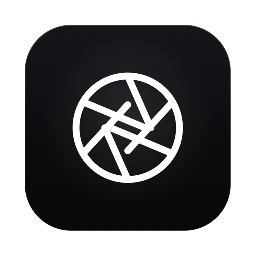
</a>

<h1>Vantage</h1>

<p><i>Your desktop, alive.</i></p>

<p>
  <b>Free, open-source live wallpapers.</b> 1,300+ motion wallpapers, procedural GPU scenes, every display — without slowing your machine down.
</p>

<p>
  <a href="https://github.com/satiricalguru/Vantage/releases/latest"></a>
  <a href="https://github.com/satiricalguru/Vantage/releases"></a>
  
  <a href="LICENSE"></a>
  <a href="https://github.com/satiricalguru/Vantage/stargazers"></a>
</p>

<p>
  <a href="https://vantage-five-navy.vercel.app"><b>Website</b></a> ·
  <a href="https://github.com/satiricalguru/Vantage/releases/latest"><b>Download</b></a> ·
  <a href="#-features">Features</a> ·
  <a href="#-generative-wallpapers">Generative</a> ·
  <a href="#%EF%B8%8F-build-from-source">Build</a> ·
  <a href="#-contributors">Contributors</a>
</p>

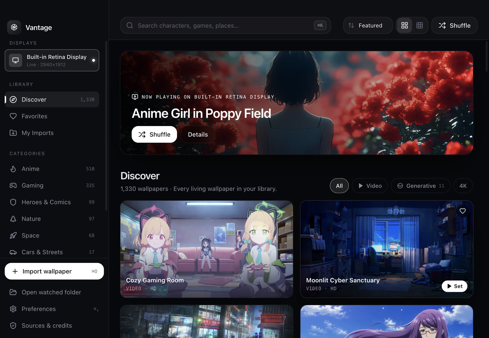

</div>

---

## ✨ Why Vantage

- 🖥️ **Every display, its own world** — assign a different wallpaper to each monitor; hot-plug a screen and Vantage picks up where it left off.
- ⚡ **4K that sips power** — videos stream straight from disk with HTTP range requests, and Vantage drops to battery-saver cadence the moment you unplug.
- 🌌 **Generative scenes** — 8 GPU shader wallpapers render live and react to your cursor. Nothing to download, and they never loop.
- 📂 **Bring your own** — import MP4, MOV, WebM, PNG, JPG or WebP, or drop files into a watched folder and they appear instantly.
- 🎛️ **Out of your way** — lives in the menu bar and the Dock (hide the Dock icon any time), pause or swap from the tray, ⌘K to search 1,300+ wallpapers.
- 🔓 **Free & open source** — MIT licensed, no account, no tracking.

<div align="center">
  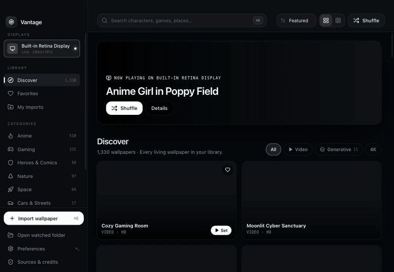
</div>

## 📸 Features

<table>
  <tr>
    <td width="50%">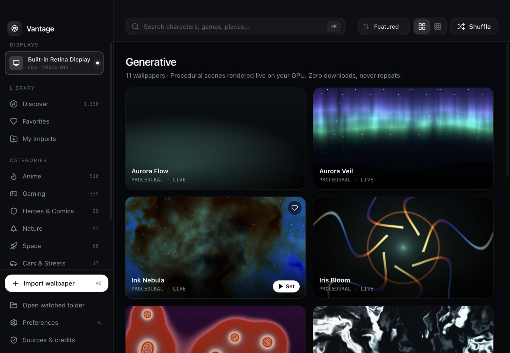</td>
    <td width="50%">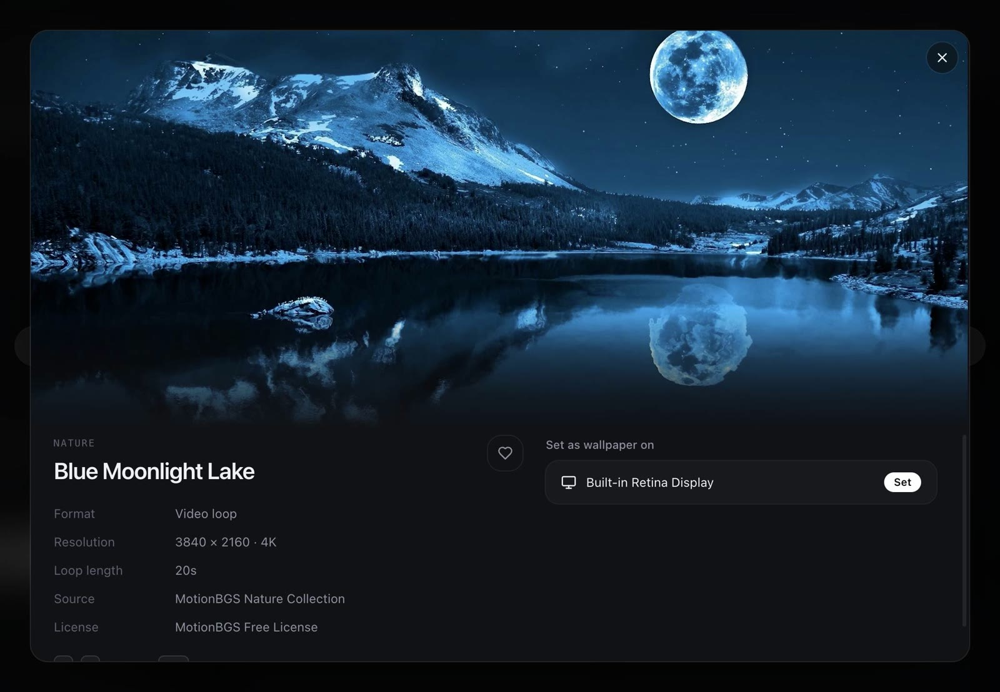</td>
  </tr>
  <tr>
    <td align="center"><b>Generative canvases</b><br /><sub>Procedural scenes rendered on your GPU, previewed live in the grid.</sub></td>
    <td align="center"><b>Detail &amp; apply</b><br /><sub>Streaming preview, source and license, set per display. ← → to browse.</sub></td>
  </tr>
  <tr>
    <td width="50%">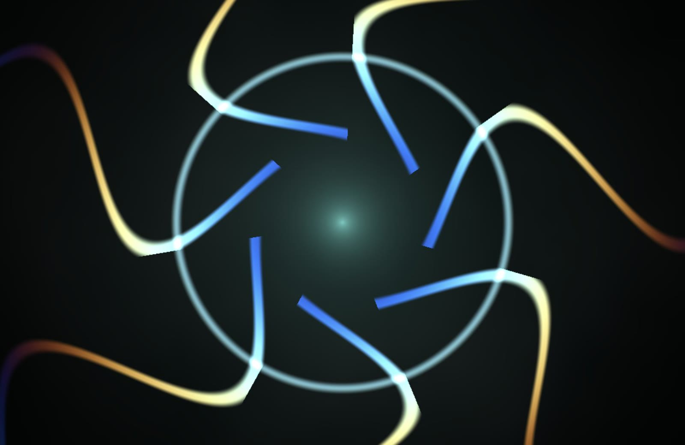</td>
    <td width="50%">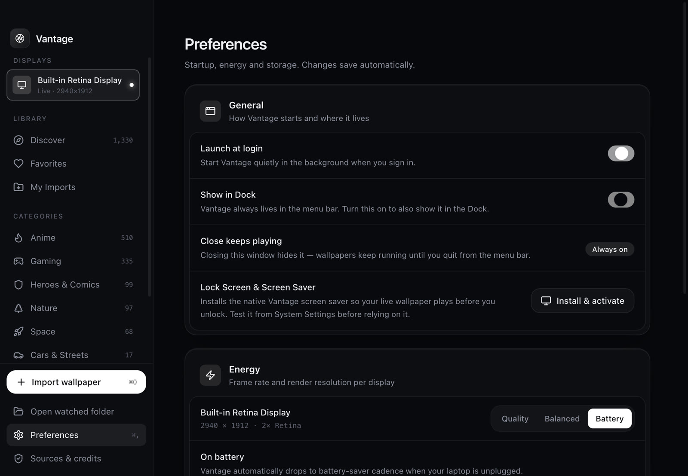</td>
  </tr>
  <tr>
    <td align="center"><b>On your actual desktop</b><br /><sub>Iris Bloom running live behind your icons.</sub></td>
    <td align="center"><b>Preferences</b><br /><sub>Energy mode per display, Dock &amp; login options, cache control.</sub></td>
  </tr>
</table>

<details>
<summary><b>Everything Vantage does</b></summary>

| | |
|:--|:--|
| **Library** | 1,330 wallpapers across Anime, Gaming, Heroes &amp; Comics, Nature, Space, Cars &amp; Streets, Digital Art, Generative and your own Still Images |
| **Gallery** | Now Playing banner with Shuffle, live display cards, category counts, ⌘K search, sort by featured / A–Z / resolution, two grid densities, hover-to-preview, one-click **Set**, favorites |
| **Multi-monitor** | Independent wallpaper and energy mode per display, apply to all, hot-plug aware |
| **Energy** | Quality (60 fps), Balanced (30 fps), Battery (15 fps); shaders also lower their render resolution; automatic battery-saver when unplugged |
| **Streaming** | Custom `media://` protocol with HTTP 206 range requests; downloaded wallpapers cached on disk with a configurable limit |
| **Imports** | File picker (⌘O) or the watched `~/Pictures/Vantage Wallpapers/` folder (videos) and its `Static/` subfolder (images) |
| **macOS** | Desktop-level windows behind your icons, menu bar + Dock (toggle the Dock icon from the menu bar), native Screen Saver companion for the Lock Screen |
| **Windows (beta)** | Wallpaper attached behind desktop icons via WorkerW, tray menu, NSIS installer |

</details>

## 🌌 Generative wallpapers

Rendered in real time by GLSL shaders (`src/renderer/shared/shaders.ts`). They follow your cursor and scale their resolution with the energy mode.

| | | | |
|:--:|:--:|:--:|:--:|
| **Iris Bloom** | **Liquid Chrome** | **Silk Waves** | **Neon Horizon** |
| Aperture kaleidoscope | Domain-warped metal | Layered pastel bands | Synthwave sun &amp; grid |
| **Ink Nebula** | **Warp Drive** | **Aurora Veil** | **Lava Lamp** |
| Drifting clouds &amp; stars | Light-speed streaks | Northern lights | Metaballs that chase the cursor |

Plus three classic canvas scenes: **Quantum Field**, **Aurora Flow** and **Nebula Drift**.

<div align="center">
  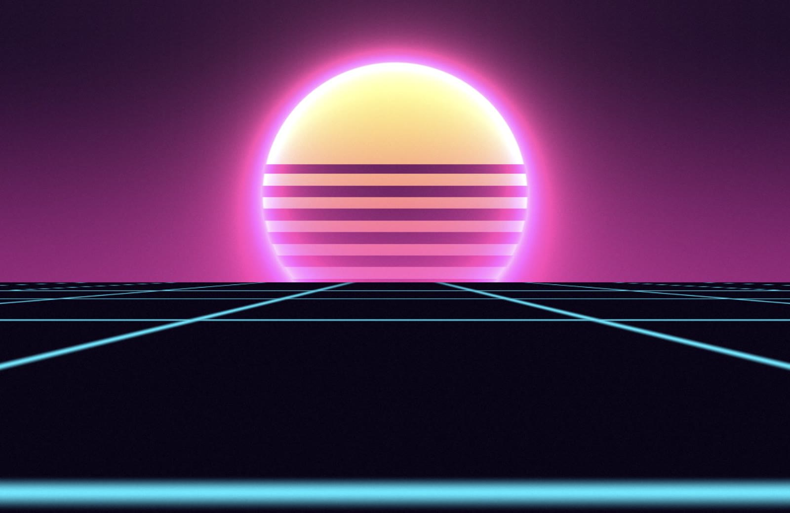
</div>

## 📥 Download

| Platform | Get it | Notes |
|:--|:--|:--|
| 🍏 **macOS** (Apple Silicon &amp; Intel) | [Latest release](https://github.com/satiricalguru/Vantage/releases/latest) | Open the `.dmg` and drag Vantage to Applications |
| 🪟 **Windows 10/11** (beta) | [Latest release](https://github.com/satiricalguru/Vantage/releases/latest) | Run `Vantage-Setup-…-x64.exe` (or `-arm64.exe`). The installer isn't code-signed yet, so SmartScreen may ask you to confirm |

> [!NOTE]
> If macOS says it can't verify the app, don't remove the quarantine flag. Use a release that's Developer ID–signed and notarized, and check its published checksum.

Or visit **[vantage-five-navy.vercel.app](https://vantage-five-navy.vercel.app)** — the download button picks the right file for your Mac.

## 🌐 The website

The landing page lives in [`website/`](website/README.md): a Three.js / WebGL scroll experience. A 3D monitor plays a wallpaper, the camera dives into the screen, the Vantage aperture falls through a tunnel lined with real wallpapers, and you land on the download.

<div align="center">
  <a href="https://vantage-five-navy.vercel.app">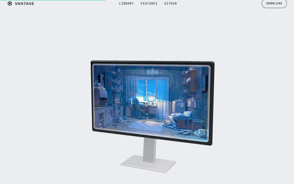</a>
  <br />
  <sub><a href="assets/media/website-dive.mp4">Watch in higher quality (MP4)</a></sub>
</div>

<table>
  <tr>
    <td width="50%">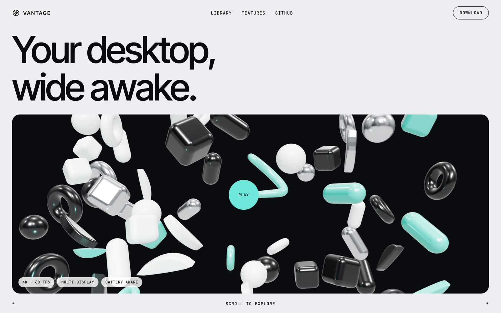</td>
    <td width="50%">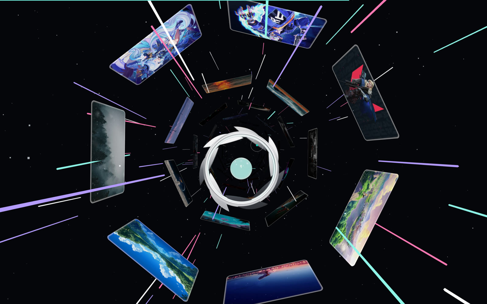</td>
  </tr>
  <tr>
    <td width="50%">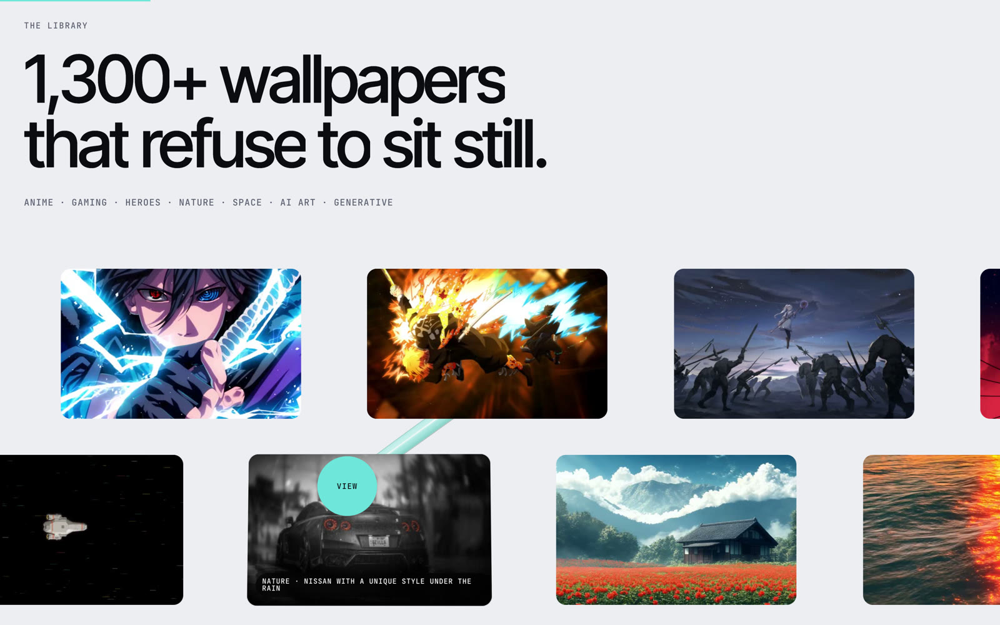</td>
    <td width="50%">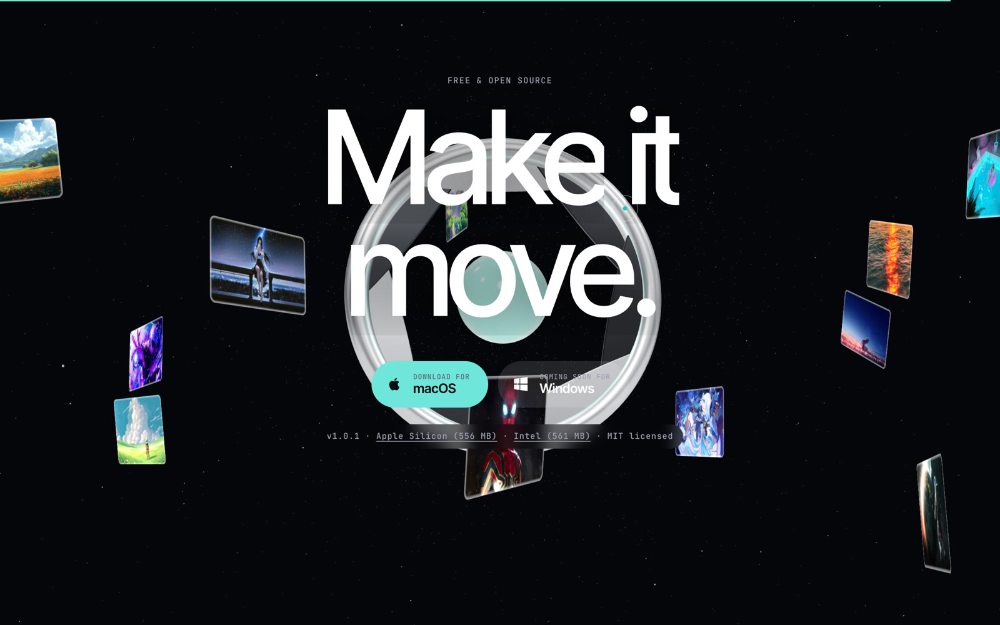</td>
  </tr>
</table>

## 🛠️ Build from source

**Requirements:** Node.js 20.19+ and npm. Building the macOS Screen Saver companion needs Xcode command-line tools.

```bash
git clone https://github.com/satiricalguru/Vantage.git
cd Vantage
npm install
npm run dev
```

<details>
<summary><b>All scripts</b></summary>

| Command | What it does |
|:--|:--|
| `npm run dev` | Run the app with hot reload |
| `npm run typecheck` | TypeScript check across main, preload and renderer |
| `npm run preview:ui` | Preview the gallery UI in a browser with a mocked API — no Electron needed (`http://localhost:5181/gallery.html`) |
| `npm run audit:catalog` | Report category mistakes, duplicates and missing files in the wallpaper catalog (`--write` fixes, `--links` checks every URL) |
| `npm run dist:mac` | Build `.dmg` + `.zip` for Apple Silicon and Intel |
| `npm run dist:win` | Build the NSIS installer for Windows x64 / arm64 (run on Windows or CI) |
| `npm --prefix website run dev` | Run the website locally |

Pushing a `v*` tag runs [`.github/workflows/release.yml`](.github/workflows/release.yml), which builds macOS and Windows installers and attaches them to a draft release.

</details>

## 🏛️ How it works

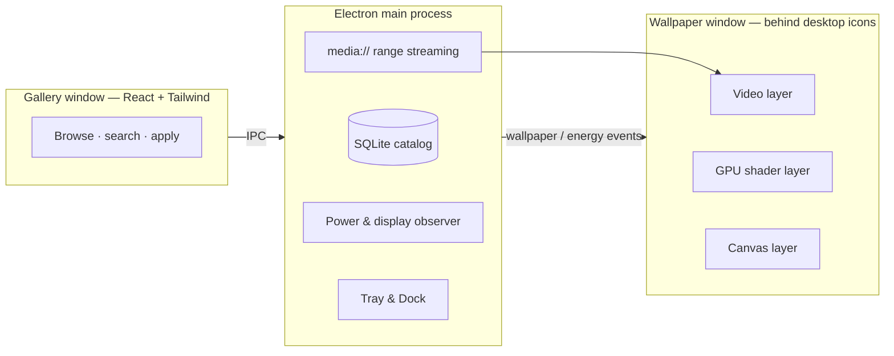

<details>
<summary><b>Tech stack &amp; folder structure</b></summary>

**Stack:** Electron 43 · React 18 · TypeScript · Tailwind CSS · Vite (`electron-vite`) · better-sqlite3 · Lucide icons · koffi (Windows desktop attach) · Three.js + Lenis (website)

```
Vantage/
├── src/
│   ├── main/            # Electron main: DB, IPC, tray, dock, power, wallpaper windows
│   │   └── platform/    # Windows desktop attach (WorkerW)
│   ├── preload/         # Context bridges
│   └── renderer/
│       ├── gallery/     # Gallery UI (screens, components, store)
│       ├── wallpaper/   # Video, shader and canvas wallpaper layers
│       └── shared/      # GLSL shader library
├── resources/           # Catalog, bundled wallpapers, thumbnails, icons
├── native/              # macOS Screen Saver companion (Swift)
├── scripts/             # Icon, screen saver and catalog tooling
└── website/             # Landing page (Vite + Three.js)
```

</details>

## 🗺️ Roadmap

- [x] Redesigned gallery with Now Playing, Shuffle and ⌘K search
- [x] GPU shader wallpapers
- [x] Catalog audit and recategorization
- [x] Landing page with download links that resolve the latest release
- [x] First Windows release (beta)
- [ ] Developer ID signing and notarization for macOS
- [ ] Playlists and timed rotation
- [ ] More procedural scenes

## 🤝 Contributors

<table>
  <tr>
    <td align="center" width="140">
      <a href="https://github.com/satiricalguru"><br /><sub><b>satiricalguru</b></sub></a><br /><sub>Creator &amp; maintainer</sub>
    </td>
    <td align="center" width="140">
      <a href="https://github.com/Mxhi-04"><br /><sub><b>Mahi Patni</b></sub></a><br /><sub><a href="https://github.com/Mxhi-04">@Mxhi-04</a></sub>
    </td>
  </tr>
</table>

Contributions are welcome — open an [issue](https://github.com/satiricalguru/Vantage/issues) or a pull request. Run `npm run typecheck` before submitting.

## 🙏 Acknowledgements

- Most of the streamed video catalog comes from [MotionBGS](https://motionbgs.com). Wallpaper artwork belongs to its original creators and rights holders.
- Built with [Electron](https://www.electronjs.org/), [React](https://react.dev/), [Tailwind CSS](https://tailwindcss.com/), [Three.js](https://threejs.org/) and [Lenis](https://lenis.darkroom.engineering/).

## 📄 License

[MIT](LICENSE) © 2026 Vantage Team

<div align="center">
  <br />
  <sub>If Vantage made your desktop a little more alive, consider giving it a ⭐ · <a href="#top">Back to top ↑</a></sub>
</div>
